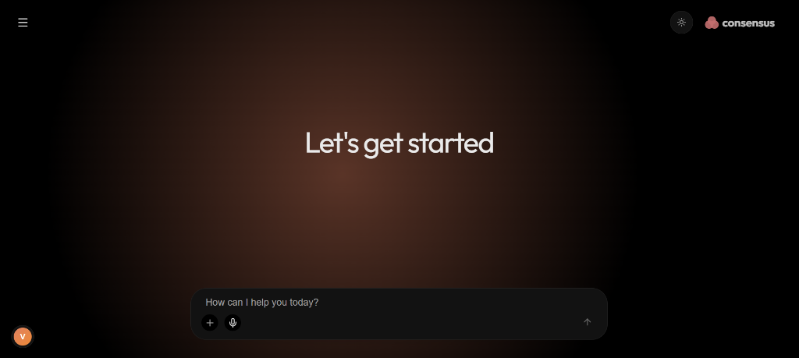
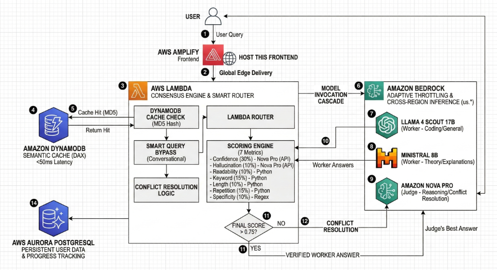

# Consensus Bedrock Engine

- **Live Demo**: [https://prototype.d3ddhsf8bhejkw.amplifyapp.com/](https://prototype.d3ddhsf8bhejkw.amplifyapp.com/)
- **GitHub**: [https://github.com/Dibya81/consensus-engine](https://github.com/Dibya81/consensus-engine)

A **multi-agent AI consensus system** built on AWS. It routes user queries to two specialist worker LLMs, scores their answers across 7 quantitative metrics, and invokes a powerful Judge model to compare responses or provide a definitive answer — combining the speed of small models with the accuracy of frontier AI.



---

## Architecture Overview



---

## Models

| Role | Model | Provider | Strengths |
|---|---|---|---|
| **Worker 1** | Llama 4 Scout 17B | Meta | Ultra-fast, excellent at coding & general queries |
| **Worker 2** | Ministral 8B 3.0 | Mistral AI | High diversity, excellent at explanations & theory |
| **Judge** | Amazon Nova Pro | Amazon | Frontier-level reasoning, 4× cheaper than Claude |

> **Note on inference profiles**: Llama 4 Scout is accessed via a Cross-Region Inference Profile ARN, which routes traffic between `us-east-1` and `us-west-2` for high availability. Ministral 8B and Nova Pro use direct model IDs in `us-east-1`. When deploying your own instance, you must create your own Cross-Region Inference Profile for Llama 4 Scout in your AWS account and update the ARN in `lambda/lambda_function.py`.

---

## 7-Metric Scoring Engine

Each worker answer is automatically scored across 7 dimensions:

| # | Metric | Weight | How It Works |
|---|---|---|---|
| a | **Confidence Score** | 30% | Nova Pro reads the Q&A and rates confidence from 0–1 |
| b | **Keyword Match Score** | 15% | Checks if the answer contains key terms from the query |
| c | **Length Score** | 10% | Ensures the answer is long enough for the complexity of the question |
| d | **Repetition Penalty** | 15% | Penalises responses that pad with repeated words (unique word ratio) |
| e | **Readability Score** | 10% | Flesch-Kincaid formula — rewards clear, well-structured prose |
| f | **Specificity Score** | 10% | Rewards answers with numbers, proper nouns, and named entities |
| g | **Hallucination Defense** | 10% | Nova Pro rates factual accuracy of the worker's answer (0 = hallucinated) |

> **Scoring threshold**: Each worker response receives a weighted final score (0–1). After scoring, the Judge model is always invoked:
> - If **both** workers score ≤ 0.75 → `IMPROVED_BY_JUDGE`: the Judge provides the definitive correct answer, replacing both worker responses.
> - If **at least one** worker scores > 0.75 → `COMPARISON`: the Judge compares both responses and explains which is better.
>
> When a response is served from cache, all LLM calls (including the Judge) are skipped entirely.

---

## AWS Bedrock Best-Practice Implementations

### Adaptive Throttling (HTTP 429 Prevention)
```python
retry_config = Config(retries={'max_attempts': 5, 'mode': 'adaptive'})
bedrock_client = boto3.client('bedrock-runtime', config=retry_config)
```
Automatically backs off and retries on AWS rate-limit errors.

### Cross-Region Inference (High Availability for Llama 4 Scout)
Llama 4 Scout is accessed via a Cross-Region Inference Profile:
```
us.meta.llama4-scout-17b-instruct-v1:0
```
If `us-east-1` is overloaded, AWS silently re-routes to `us-west-2`. See the [deployment note](#models) above for how to configure this for your account.

### LLM Cascade & Router Pattern (Cost Optimisation)
The Judge compares responses for high-quality answers and replaces responses only when both workers fail. DynamoDB and Aurora caching eliminates redundant API calls for repeated queries.

### Dual-Layer Semantic Cache (Latency & Cost Elimination)
Identical queries are hashed (`{username}_{MD5(query)}`) and checked against:
1. **Amazon Aurora** (primary cache) — sub-100 ms reads
2. **Amazon DynamoDB** (`semantic_cache` table, fallback) — sub-50 ms reads

Cache hits bypass all Bedrock API calls entirely.

### Smart Query Bypass (Conversational Intelligence)
Hundreds of conversational triggers are detected to bypass strict keyword/length penalties for small-talk, greetings, and simple utility queries — ensuring a natural user experience.

---

## Features

Beyond the core consensus engine, the application includes:

| Feature | Description |
|---|---|
| **Multi-session Chat** | Full conversation history, persisted per user across sessions |
| **Deep Dive Analysis** | On-demand Nova Pro comparison of both worker responses with detailed commentary |
| **Notes** | Save and analyse study notes; generate revision flashcards via Nova Pro |
| **Code Hub** | Write code with syntax highlighting; simulate execution via Nova Pro acting as a compiler |
| **Career Roadmaps** | Generate structured learning roadmaps with resources via Llama 4 |
| **Progress Tracker** | Visualise learning activity with AI coaching feedback |
| **Community** | Community view within the app |
| **Voice Input** | Web Speech API integration (Chrome required) for hands-free query input |
| **File Attachments** | Attach images and documents (base64-encoded) alongside text queries |
| **Dark Mode** | Full light/dark theme toggle |

---

## Deployment

### Prerequisites

**AWS account setup (manual — before running CDK):**

1. **Amazon Aurora PostgreSQL Serverless v2** — Create a cluster with the Data API enabled. Note the Cluster ARN.
2. **AWS Secrets Manager** — Create a secret with the Aurora database credentials. Note the Secret ARN.
3. **Amazon DynamoDB** — Create a table named `semantic_cache` with partition key `question_hash` (String). The CDK stack references this table by name; it does not create it.
4. **AWS Bedrock model access** — Enable access to Llama 4 Scout, Ministral 8B, and Amazon Nova Pro in the AWS Bedrock console for your region.
5. **Cross-Region Inference Profile** — Create a Cross-Region Inference Profile for `us.meta.llama4-scout-17b-instruct-v1:0` in your account and copy the resulting ARN.

**Local tools required:**
- AWS CLI configured (`aws configure`)
- Python 3.9+
- Node.js (for CDK CLI)

### Backend Setup & Deployment

```powershell
# 1. Clone and enter the project
cd consensus-engine

# 2. Create and activate virtual environment (Windows)
python -m venv .venv
.venv\Scripts\activate.bat

# 3. Install Python dependencies
pip install aws-cdk-lib constructs python-dotenv

# 4. Copy the environment variable template and fill in your values
copy .env.example .env
# Edit .env with your actual DB_CLUSTER_ARN, DB_SECRET_ARN, DB_NAME,
# CDK_DEFAULT_ACCOUNT, and CDK_DEFAULT_REGION

# 5. Install CDK CLI
npm install -g aws-cdk

# 6. Bootstrap your AWS account (first time only)
cdk bootstrap

# 7. Deploy
cdk deploy
```

After deployment the terminal will print:
```
ConsensusBedrockStack.ConsensusAPIEndpoint = https://<id>.lambda-url.us-east-1.on.aws/
```

> **Important**: Copy this URL. You must paste it into `frontend-app/src/pages/EnginePage.jsx` on line 17 before the frontend will work:
> ```js
> const LAMBDA_URL = "https://<your-lambda-url>.lambda-url.us-east-1.on.aws/";
> ```

> **Important**: The Llama 4 Scout model ID in `lambda/lambda_function.py` is set to a specific AWS account ARN. Replace it with the Cross-Region Inference Profile ARN you created in your own account.

### Frontend Setup

```powershell
cd frontend-app

# Install Node.js dependencies
npm install

# Start the development server
npm run dev
# → http://localhost:5173

# Build for production (output goes to frontend-app/build/)
npm run build
```

### AWS Amplify (Frontend — Production Deployment)
The frontend is deployed via **AWS Amplify** for global edge delivery:
- **CI/CD**: Auto-deploys on every push to the `main` branch.
- **Build output directory**: Set to `build` (not `dist`) in the Amplify build settings, to match the Vite configuration.

---

## Lambda API Reference

The backend exposes a single Lambda Function URL that accepts `POST` requests with a JSON body. The `action` field routes the request.

| Action | Description | Required Fields |
|---|---|---|
| `query` *(default)* | Full consensus pipeline: cache check → dual worker → scoring → judge | `query`, `username` |
| `JUDGE_DEEP_DIVE` | Nova Pro compares both worker responses in detail | `query`, `username`, `llama_content`, `ministral_content` |
| `GET_USER_DATA` | Retrieve persisted user data (notes, chat sessions, etc.) | `username`, `data_type` |
| `SAVE_USER_DATA` | Persist user data to Aurora and DynamoDB | `username`, `data_type`, `payload` |
| `DELETE_USER_DATA` | Delete user data record | `username`, `data_type` |
| `ANALYZE_DATA` | AI analysis via Nova Pro (code, progress) or notes consensus via workers | `data_type`, `payload` |
| `EXECUTE_CODE` | Simulate code execution via Nova Pro acting as a compiler/runtime | `code`, `language` |
| `GENERATE_CAREER_ROADMAP` | Generate a structured career/learning roadmap JSON via Llama 4 | `topic` |

**Rate limiting**: 60 requests per minute per IP address. Exceeding the limit returns HTTP `429`.

**Example request (`query` action):**
```json
{
  "action": "query",
  "query": "Explain how photosynthesis works",
  "username": "alice"
}
```

**Example response (`COMPARISON` status):**
```json
{
  "cached": false,
  "data": {
    "status": "COMPARISON",
    "responses": [
      { "model_name": "Llama 4 Scout 17B", "content": "...", "consensus_score": 0.82 },
      { "model_name": "Ministral 8B 3.0", "content": "...", "consensus_score": 0.79 }
    ],
    "judge_explanation": "...",
    "judge_invoked": true
  }
}
```

---

## Environment Variables

Copy `.env.example` to `.env` and fill in the following values before running CDK:

| Variable | Required | Description |
|---|---|---|
| `DB_CLUSTER_ARN` | Yes | ARN of your Aurora Serverless v2 cluster |
| `DB_SECRET_ARN` | Yes | ARN of the Secrets Manager secret for Aurora credentials |
| `DB_NAME` | No | Database name (defaults to `postgres`) |
| `CDK_DEFAULT_ACCOUNT` | Yes | Your AWS account ID |
| `CDK_DEFAULT_REGION` | No | AWS region (defaults to `us-east-1`) |

> The variables `PORT`, `DB_USER`, `DB_PASSWORD`, and `OLLAMA_URL` in `.env.example` are legacy placeholders and are not used by this application.

---

## Project Structure

```
consensus-engine/
│
├── app.py                              # CDK app entry point
├── .env.example                        # Environment variable template
├── cdk.json                            # CDK configuration
│
├── consensus_bedrock_backend/
│   └── consensus_bedrock_stack.py      # CDK Stack: Lambda + IAM + Function URL
│
├── lambda/
│   └── lambda_function.py              # Core AI logic: agents, router, scoring, judge
│
├── frontend-app/                       # React + Vite frontend
│   ├── package.json
│   ├── vite.config.js                  # Build output: build/
│   └── src/
│       ├── App.jsx                     # Router: /, /chat, /architecture, /metrics
│       ├── pages/
│       │   ├── LandingPage.jsx         # Username entry
│       │   ├── EnginePage.jsx          # Main chat + all feature tabs
│       │   ├── ArchitecturePage.jsx    # Architecture info page
│       │   └── MetricsPage.jsx         # Metrics info page
│       └── components/
│           ├── ChatMessage.jsx
│           ├── NotesView.jsx
│           ├── CodeHubView.jsx
│           ├── ProgressView.jsx
│           ├── CareerView.jsx
│           ├── CommunityView.jsx
│           └── Logo.jsx
│
└── images/
    ├── architecture_diagram.png
    └── frontend_preview.png
```

---

## Useful CDK Commands

| Command | Description |
|---|---|
| `cdk deploy` | Deploy stack to AWS |
| `cdk destroy` | Delete all AWS resources |
| `cdk diff` | Preview changes before deploying |
| `cdk synth` | Emit the CloudFormation template |
| `cdk ls` | List all stacks |

---

## Example Queries

| Query Type | Example | Expected Result |
|---|---|---|
| Conversational | `hi` | COMPARISON — Llama answers instantly, Judge compares |
| Coding | `write a python function to sort a list` | COMPARISON — both workers answer, Judge picks the better one |
| Theory | `explain how photosynthesis works` | COMPARISON — Ministral explains clearly, Judge compares |
| Complex Logic | `A farmer has a wolf, a goat, and a cabbage...` | IMPROVED_BY_JUDGE — if both workers hallucinate, Judge provides the definitive answer |

---

## Cost Estimate

Running 1,000 queries per day:

| Resource | Estimated Cost |
|---|---|
| Lambda Invocations | ~$0.00 (free tier) |
| Llama 4 Scout (Worker) | ~$0.01/day |
| Ministral 8B (Worker) | ~$0.01/day |
| Amazon Nova Pro (Judge, invoked on all live queries) | ~$0.04/day |
| DynamoDB Cache reads | ~$0.00 (free tier) |
| Aurora Serverless v2 | ~$0.01/day (scales to zero when idle) |
| **Total** | **~$0.07/day** |

> Costs are approximate. Use the [AWS Pricing Calculator](https://calculator.aws) for exact estimates.

---

## Known Limitations

| Limitation | Detail |
|---|---|
| **Hardcoded Lambda URL** | The Lambda Function URL is hardcoded in `EnginePage.jsx`. It must be manually updated after each `cdk deploy`. |
| **Hardcoded inference profile ARN** | The Llama 4 Scout model ARN in `lambda_function.py` is specific to the original development AWS account. Deployers must replace it with their own Cross-Region Inference Profile ARN. |
| **In-memory rate limiting** | The 60 req/min rate limit uses an in-memory dictionary. It resets on every Lambda cold start and is not shared across concurrent Lambda instances. |
| **Aurora pre-provisioning required** | The CDK stack does not provision the Aurora cluster. It must be created manually before `cdk deploy`. |
| **DynamoDB table pre-provisioning required** | The `semantic_cache` DynamoDB table must be created manually. CDK references it by name but does not create it. |
| **`DELETE_USER_DATA` Aurora path** | The Aurora deletion path in this action calls a method that is not implemented. Data is deleted from DynamoDB only. Aurora records for deleted items persist until overwritten. |
| **No cache TTL** | Cached responses in both Aurora and DynamoDB do not expire automatically. Stale responses must be cleared manually if needed. |
| **Voice input — Chrome only** | The voice input feature relies on the Web Speech API (`webkitSpeechRecognition`), which is only supported in Google Chrome. |
